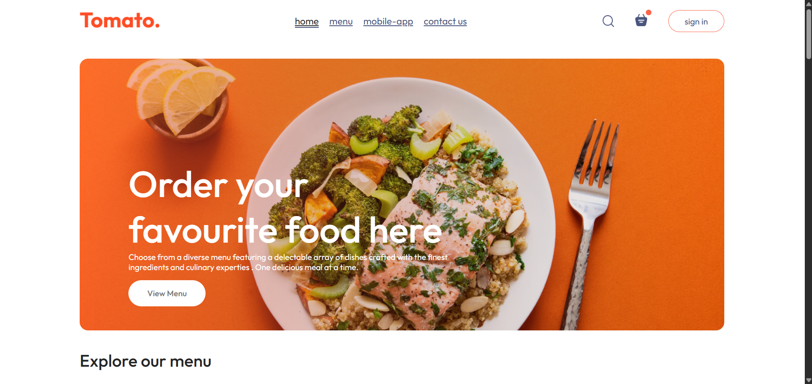

# 🍔 Food Delivery App

<p align="center">
  
  
  
  
</p>

<p align="center">
  A modern and responsive food delivery web application built with React and Vite.
  <br />
  Browse delicious meals, explore food categories, and manage your shopping cart through a clean and intuitive interface.
</p>

<p align="center">
  <a href="https://github.com/Osama-dev20/food-delivery-app">
    <strong>View Repository</strong>
  </a>
</p>

---

## 📸 Preview

<!-- Replace this image with a screenshot of your actual application -->
<p align="center">
  
</p>

<p align="center">
  <em>Responsive food delivery interface for desktop and mobile devices.</em>
</p>

## ✨ Features

- 🥗 **Explore Food Menu** — Browse food items and discover different categories.
- 🔎 **Category Filtering** — Filter dishes by selecting a food category.
- 🛒 **Shopping Cart** — Add items, change quantities, and remove products.
- 💰 **Cart Summary** — Calculate subtotal, delivery fee, and total price.
- 💾 **Persistent Cart** — Keep cart data in the browser using Local Storage.
- 📦 **Order Page** — Enter delivery details and review order information.
- 📱 **Responsive Design** — Adapt the interface to different screen sizes.
- 🧩 **Reusable Components** — Organize the application into maintainable React components.

## 🛠️ Tech Stack

| Technology | Purpose |
|---|---|
| React | Building the user interface |
| Vite | Development server and build tooling |
| JavaScript | Application logic |
| CSS3 | Styling and responsive layouts |
| React Router | Client-side navigation |
| Context API | Sharing application state |
| Git & GitHub | Version control and project hosting |

## 📂 Project Structure

```text
food-delivery-app/
├── frontend/
│   ├── public/
│   ├── src/
│   │   ├── assets/
│   │   ├── components/
│   │   │   ├── AppDownload/
│   │   │   ├── ExploreMenu/
│   │   │   ├── FoodDisplay/
│   │   │   ├── FoodItem/
│   │   │   ├── Footer/
│   │   │   ├── Hero/
│   │   │   └── Navbar/
│   │   ├── context/
│   │   │   └── StoreContext.jsx
│   │   ├── pages/
│   │   │   ├── Home/
│   │   │   ├── Cart/
│   │   │   └── PlaceOrder/
│   │   ├── App.jsx
│   │   └── main.jsx
│   └── package.json
├── .gitignore
└── README.md
```

## 🚀 Getting Started

### Prerequisites

- [Node.js](https://nodejs.org/)
- npm

### Installation

**1. Clone the repository**

```bash
git clone https://github.com/Osama-dev20/food-delivery-app.git
```

**2. Navigate to the frontend directory**

```bash
cd food-delivery-app/frontend
```

**3. Install dependencies**

```bash
npm install
```

**4. Start the development server**

```bash
npm run dev
```

**5. Open the local URL** shown in your terminal to explore the application.

## 🗺️ Roadmap

- [x] Build the main application interface.
- [x] Create reusable React components.
- [x] Implement food category filtering.
- [x] Implement shopping cart interactions.
- [x] Create the order information page.
- [ ] Develop the backend API.
- [ ] Connect the frontend to the backend.
- [ ] Implement user authentication.
- [ ] Store menu items and orders in a database.
- [ ] Integrate a payment provider.

## 🔮 Future Plans

The next development phase will focus on building the backend and connecting it to the existing frontend to support real menu data, user accounts, order management, and payment integration.

## 👨‍💻 Author

**Osama Alkhatib**

Computer Science Student | Frontend Developer

<p>
  <a href="https://github.com/Osama-dev20">
    
  </a>
</p>

---

<p align="center">
  <sub>Built with React, curiosity, and a passion for web development. 🚀</sub>
</p>